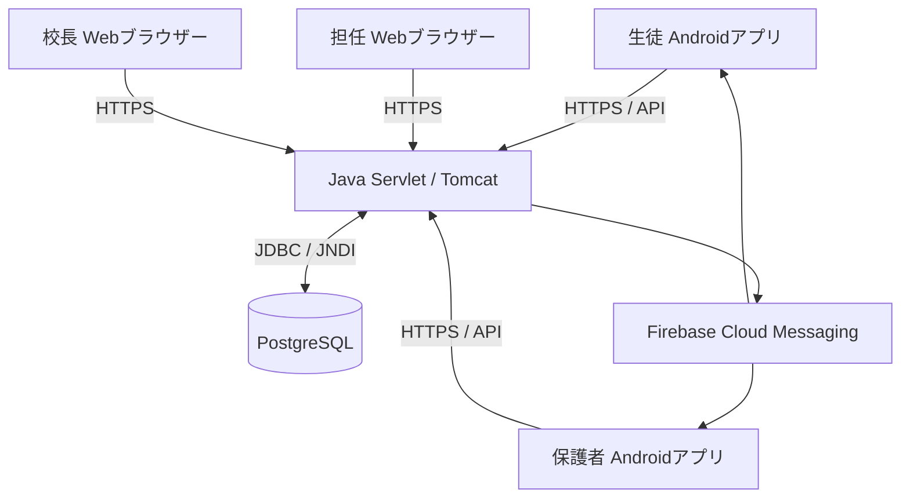

# AnpiLink（学校安否確認システム）

大原簿記情報ビジネス専門学校 大宮校｜卒業制作・グループ6

## 1. システム概要

AnpiLinkは、災害や緊急時における生徒の安否確認を迅速に行い、学校と保護者の間で情報を共有するためのシステムです。

生徒・保護者はAndroidアプリを利用し、担任・校長はWebブラウザーから安否状況の確認や学校運営に必要な情報の管理を行います。災害時の通信環境を考慮し、安否回答のオフライン保存・再送信にも対応しています。また、学校からの通常連絡にも利用できる通知配信機能を備えています。

## 2. 利用方法

| 利用者 | 利用環境 |
| --- | --- |
| 生徒 | Androidアプリ |
| 保護者 | Androidアプリ |
| 担任 | Webブラウザー |
| 校長 | Webブラウザー |

**Web版（AWS）**： [AnpiLink ログイン画面](https://ohara-group6.duckdns.org/school-safety/safety/auth/Login.action)

**Android版**： 配布された `AnpiLink.apk` をAndroid端末にインストールして利用します。学校から案内されたアカウントでログインしてください。通知や位置情報を利用する場合は、必要な権限を許可してください。

> 卒業制作のためのシステムです。実際の災害時には、公的機関や学校の指示に従って行動してください。

## 3. 主な機能

### 生徒（Android）

- 安否回答（無事・危険・困っている）
- 位置情報を付加した安否報告
- 困っている内容の選択およびコメント入力
- 危険報告の送信後、所定時間内の取り消し
- オフライン時の安否回答の保存および再送信
- 学校からの連絡（安否確認通知・通常通知）の閲覧
- 安否確認通知への回答、既読・未読管理
- プッシュ通知および通知・位置情報の設定

### 保護者（Android）

- アカウント登録、子どもとの関連付け申請
- 関連付け済みの子どもの安否状況一覧・回答詳細の確認
- 報告時の位置情報およびコメントの確認（登録されている場合）
- 学校からの通常通知および催促通知の閲覧
- 子どもの安否回答や未回答に関するプッシュ通知の受信
- 既読・未読管理、通知設定

### 担任（Web）

- 担当クラスの生徒一覧・安否回答状況の確認
- 生徒の回答詳細および位置情報の確認
- 保護者からの関連付け申請の承認・却下
- 学校からの通常通知の閲覧、既読・未読管理

### 校長（Web）

- 全校の安否回答状況の集計・確認
- 学年別・クラス別・生徒別の安否状況および回答詳細の確認
- 通知配信（安否確認通知・通常通知）
- グループ管理（クラス管理・担当職員の割り当て）
- 職員管理（登録・編集・無効化）
- 困っている内容の管理（選択項目の追加・削除）

## 4. 通知配信機能

| 項目 | 安否確認通知 | 通常通知 |
| --- | --- | --- |
| 配信対象 | 全生徒 | 全生徒・全保護者・全職員・全員から選択 |
| 通知内容 | 災害の種類に応じた安否確認 | 任意のタイトル・メッセージ |
| 回答期限 | あり | なし |
| 安否回答 | 必要 | 不要 |
| 催促通知 | 期限超過時、未回答の生徒に関連付けられた保護者へ通知 | なし |

通知は受信者ごとに管理し、既読・未読と安否確認への回答状況を区別しています。Android端末へのプッシュ通知にはFirebase Cloud Messaging（FCM）を使用します。通知設定や端末の状態によってはプッシュ通知が届かない場合がありますが、配信済みの通知はアプリ内で確認できます。

## 5. システム構成



## 6. 使用技術・開発環境

| 分類 | 使用技術 |
| --- | --- |
| Web・バックエンド | Java 21、Jakarta Servlet、JSP、JSTL、HTML、CSS、JavaScript |
| Android | Kotlin、Jetpack Compose、Gradle |
| データベース | PostgreSQL 16、JDBC、JNDI |
| Webアプリケーションサーバー | Apache Tomcat 10 |
| 通知 | Firebase Cloud Messaging（FCM） |
| インフラ | AWS EC2、HTTPS |
| 開発ツール | Eclipse、Android Studio、pgAdmin |
| バージョン管理 | Git、GitHub |

## 7. リポジトリ構成

```text
 oharaomiya_group6_dev/
 ├── src/main/
 │   ├── java/               # Servlet、Action、DAO、API等
 │   └── webapp/             # JSP、CSS、JavaScript等
 ├── android/AnpiLink/       # Androidアプリ
 ├── sql/                    # データベース関連SQL
 └── README.md               # 本ファイル
```

Web側はFrontController、Action、DAOを使用し、画面表示と業務処理、データベースアクセスを分離しています。

## 8. 開発環境での起動方法

### 8.1 Web・バックエンド

1. リポジトリをクローンします。

   ```bash
   git clone https://github.com/tuyetjp1998-a11y/oharaomiya_group6_dev.git
   ```

2. EclipseにWebプロジェクトをインポートし、Java 21とTomcat 10を設定します。
3. PostgreSQLに `school_safety_db` を用意し、初期構築用SQLと未適用のマイグレーションを順番に適用します。既存のデータベースに適用する場合は、事前にバックアップを取得してください。
4. JNDIデータソースに接続先、データベースユーザーおよびパスワードを設定します。必要に応じてFCMの認証情報を安全な方法で設定します。
5. Tomcatにアプリケーションを追加し、起動します。
6. ブラウザーで `http://localhost:8080/school-safety/safety/auth/Login.action` にアクセスします。

### 8.2 Android

1. Android Studioで `android/AnpiLink/` を開き、Gradle Syncを実行します。
2. 使用するFirebaseプロジェクトの設定を確認します。
3. `app/src/main/java/com/example/anpilink/ApiConfig.kt` の接続先を確認します。

   | 環境 | BASE_URL |
   | --- | --- |
   | AWS | `https://ohara-group6.duckdns.org/school-safety` |
   | ローカル（Android Emulator） | `http://10.0.2.2:8080/school-safety` |

4. Android EmulatorまたはAndroid実機で起動し、ログインします。

### 8.3 APKのビルド（Windows）

Androidプロジェクトのルートディレクトリで実行します。

```powershell
.\gradlew.bat clean assembleDebug
```

生成先： `app/build/outputs/apk/debug/app-debug.apk`

※ Debug APKは卒業制作の動作確認・デモ用です。

## 9. セキュリティ・データ管理

- 利用者の役割およびログイン状態に基づくアクセス制御
- Android APIのアクセストークンによる認証
- Webの更新処理におけるCSRF対策
- 安否回答や通知の受信者・関連付けに基づくデータ参照制限
- 本番環境でのHTTPS通信
- データベースの制約によるデータ整合性の確保

パスワード、秘密鍵、Firebaseサービスアカウントの認証情報、AWSの認証情報などはGitHubに登録しないでください。

## 10. 開発・制作

- 制作名：AnpiLink（学校安否確認システム）
- 制作チーム：大原簿記情報ビジネス専門学校 大宮校 グループ6
- 用途：卒業制作
- ソースコード： [GitHub リポジトリ](https://github.com/tuyetjp1998-a11y/oharaomiya_group6_dev)

